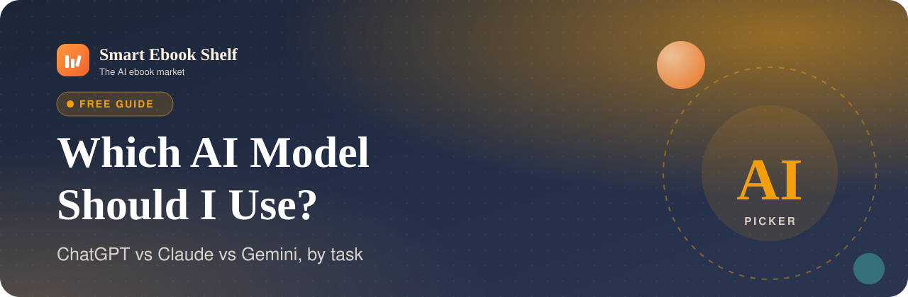

# Which AI Model Should I Use? ChatGPT vs Claude vs Gemini (and More)

A simple, practical guide to picking the right AI tool for the job: **writing, long documents, coding, research, images, video, Google or Microsoft apps, and private use**. No hype, no "best AI ever" claims.

> Short version of **[Which AI Model Should You Actually Use?](https://bestbookdotcom.gumroad.com/l/ai-model-field-guide)**, an illustrated field guide with 8 "AI species", a decision map and 12 prompt recipes. Free 6-page version: **[The AI Model Cheat Sheet](https://bestbookdotcom.gumroad.com/l/ai-model-cheat-sheet)**.

*Last reviewed: November 2026. AI tools change fast: always test with your own work.*

---

## The quick answer: pick by task

| Your task | Good places to start | Why |
|---|---|---|
| **Everyday questions and writing** | ChatGPT, Claude, Gemini | All three are strong all-rounders. Try the free version of each on the same task. |
| **Long documents (contracts, reports, books)** | Claude, Gemini | Both handle very long inputs well and are good at careful summaries. |
| **Coding** | Claude, ChatGPT, Gemini | All three are strong. Pick the one that fits your editor or tools. |
| **Research with sources** | Perplexity, or ChatGPT / Claude / Gemini with web search on | You get links you can check. Always open the sources. |
| **Google Docs, Gmail, Drive** | Gemini | Built into Google Workspace. |
| **Word, Excel, Outlook, Teams** | Microsoft Copilot | Built into Microsoft 365. |
| **Images** | ChatGPT, Gemini, Midjourney | ChatGPT and Gemini make images inside the chat; Midjourney is popular for artistic styles. |
| **Video** | Veo, Sora, Kling, Runway | Text-to-video tools. Results depend a lot on the prompt. |
| **Private or offline use** | Open-weight models (Llama, Mistral, Qwen, DeepSeek) run with tools like Ollama or LM Studio | Your data stays on your own computer. Needs a decent computer. |
| **Tight budget** | The free tier of any of the big three | Only pay when you hit a real limit you feel every week. |

---

## The 3-question test (task, stakes, volume)

Before choosing a model, answer:

1. **Task:** what kind of work is it? Writing, analysis, code, images, research?
2. **Stakes:** what happens if the answer is wrong? High stakes (legal, money, health) means a stronger model **and** checking the answer yourself.
3. **Volume:** how often do you do it? Many small tasks a day favor a fast, cheap model; rare, important tasks favor the strongest one.

---

## The 10-minute taste test

Don't trust rankings. Test models on **your** work:

1. Pick one real task you do every week.
2. Write one clear prompt for it.
3. Paste the same prompt into 2–3 tools.
4. Score each answer from 1–5 on: accuracy, usefulness, tone, and how much you had to fix.
5. Use the winner for that task. Re-test every few months.

---

## Free vs paid: when to upgrade

Upgrade only when **one** of these happens every week:

- You hit the free message limit in the middle of real work.
- You need a feature that's only in the paid plan (longer files, a stronger model, more images or video).
- The paid model saves you clearly more time than it costs.

Otherwise, stay free and use 2–3 free tools side by side.

---

## Privacy checklist before you paste anything

- [ ] No passwords, card numbers or ID numbers
- [ ] No other people's personal data (clients, students, patients) without permission
- [ ] No confidential company documents unless your company approved the tool
- [ ] Check whether the tool uses your chats for training, and turn it off if you can
- [ ] For sensitive work, consider a local open-weight model

---

## FAQ

### Is ChatGPT or Claude better?

Neither is best at everything. Both are strong all-rounders; the best one is whichever gives you better results on your own task. Run the 10-minute taste test above.

### Which AI is best for free?

The free tiers of ChatGPT, Claude and Gemini are all useful. Use two side by side and upgrade only when you hit a limit every week.

### Which AI is best for writing long documents?

Claude and Gemini both handle very long inputs well. Paste a real document you work with and compare the summaries.

---

## More free AI resources

- **[Free Claude Skills: viral hooks, email replies and client proposals](https://github.com/smartebookshelf/free-claude-skills)**
- **[30 free AWS Cloud Practitioner (CLF-C02) practice questions + cheat sheet](https://github.com/smartebookshelf/aws-cloud-practitioner-practice-questions)**
- **[30 free AI video prompts for Veo, Sora, Kling and Runway](https://github.com/smartebookshelf/ai-video-prompts)**
- **[20 free ChatGPT prompts for freelancers](https://github.com/smartebookshelf/chatgpt-prompts-for-freelancers)**
- **[20 free AI prompts for teachers](https://github.com/smartebookshelf/ai-prompts-for-teachers)**
- **[20 free ChatGPT prompts to make money online](https://github.com/smartebookshelf/chatgpt-prompts-to-make-money)**
- **[2 free no-code AI agent templates](https://github.com/smartebookshelf/no-code-ai-agent-templates)**
- **[All Smart Ebook Shelf books and free PDFs](https://bestbookdotcom.gumroad.com/)**

---

## Want the full field guide?

**[Which AI Model Should You Actually Use?](https://bestbookdotcom.gumroad.com/l/ai-model-field-guide)** is a 50-page illustrated guide that teaches you to recognise **8 AI "species"** (so it still works when model names change), with the Fit Triangle, a one-page decision map, the Hype Translator, Cost per Good Answer, 12 prompt recipes and a 30-day plan.

👉 **[Get the field guide](https://bestbookdotcom.gumroad.com/l/ai-model-field-guide)** · Free: **[The AI Model Cheat Sheet](https://bestbookdotcom.gumroad.com/l/ai-model-cheat-sheet)**

---

⭐ If this helped you choose, a star helps other people find it. Found something out of date? Open an issue.

*Free to use and share with credit. Independent resource by Smart Ebook Shelf, not affiliated with any AI company. All product names are trademarks of their respective owners.*
